# Student Early-Warning System

**An explainable early-warning system that predicts, partway through a course, which students are likely to fail or withdraw, explains why, and drafts a supportive check-in message for their tutor.**

Built with Python, scikit-learn, SHAP-style explanations, a local LLM (Ollama) and Streamlit, on the Open University Learning Analytics Dataset (OULAD).

> **Results:** this section will hold the measured results on the real OULAD data once `python -m src.train` has been run on it. No results are claimed before that.

---

## The problem

Universities usually discover that a student is struggling only when final results arrive, which is too late to help. Yet the warning signs (logging in less, missing an assignment, falling scores) appear weeks earlier in the online learning system.

## What the system does

On a chosen **course day (default: day 60)**, using **only data from before that day**:

1. **Predicts** each student's risk of failing or withdrawing (machine learning).
2. **Explains** each prediction: the 3 facts that push the risk up the most, compared with a typical student (explainable AI).
3. **Drafts a check-in message** a tutor can review and send, using a local LLM (generative AI), with a safe template fallback.
4. **Shows everything on a dashboard** for teachers.

## Architecture

```mermaid
flowchart LR
    A[OULAD CSV files<br/>data/raw] --> B[data_loader.py<br/>load + validate]
    B --> C[features.py<br/>leakage-safe features at day 60]
    C --> D[train.py<br/>temporal split, model comparison,<br/>threshold for 80% recall]
    D --> E[(models/model.joblib)]
    E --> F[predict.py<br/>risk scores]
    F --> G[explain.py<br/>top reasons per student]
    G --> H[(SQLite<br/>predictions + messages)]
    H --> I[Streamlit dashboard]
    I -- "Write message" --> J[interventions.py<br/>Ollama LLM + safety check<br/>or template]
    J --> H
```



## Project structure

```
student-early-warning/
├── config.yaml              # every setting in one place (cutoff day, split, model, LLM)
├── requirements.txt
├── app/streamlit_app.py     # teacher dashboard
├── src/
│   ├── config.py            # loads config.yaml
│   ├── data_loader.py       # loads + validates the 7 OULAD tables
│   ├── verify_dataset.py    # safely unzips and checks the download
│   ├── make_sample_data.py  # SYNTHETIC data for dry runs and tests only
│   ├── eda.py               # exploratory analysis -> reports/figures
│   ├── features.py          # one row per student, only pre-cutoff information
│   ├── modeling.py          # models, metrics, threshold choice
│   ├── train.py             # trains, compares, evaluates, saves the model
│   ├── explain.py           # per-student explanations (SHAP or baseline replacement)
│   ├── interventions.py     # LLM / template check-in messages with guardrails
│   ├── predict.py           # scores students and stores results
│   ├── store.py             # SQLite database
│   └── dashboard_data.py    # dashboard helpers (tested)
├── tests/                   # pytest suite
├── reports/                 # generated figures and reports, weekly logs
├── data/                    # raw / processed / sample (not uploaded to GitHub)
└── models/                  # trained model (not uploaded to GitHub)
```

## Setup (macOS)

```bash
cd ~/projects/student-early-warning
python3.12 -m venv .venv            # only the first time
source .venv/bin/activate
pip install -r requirements.txt
pip install shap                     # optional: enables SHAP explanations
python src/check_env.py              # every line should say OK
```

## Get the dataset (safely)

1. Download the zip (about 45 MB) from the **UCI Machine Learning Repository** mirror of OULAD
   (page: <https://archive.ics.uci.edu/ml/datasets/Open+University+Learning+Analytics+Dataset>,
   direct file: <https://archive.ics.uci.edu/static/public/349/open+university+learning+analytics+dataset.zip>).
2. Unpack and verify it with the project's checker. It refuses zips that contain programs, scripts or nested archives, prints the file's SHA-256 fingerprint, and checks columns and row counts:

```bash
python -m src.verify_dataset --zip ~/Downloads/open+university+learning+analytics+dataset.zip
```

## Run the pipeline

```bash
python -m src.eda          # Week 1: charts in reports/figures, numbers in reports/eda_summary.md
python -m src.train        # Week 2: model comparison, reports/model_report.md, models/model.joblib
python -m src.predict      # Week 3: risk scores + explanations into the SQLite database
streamlit run app/streamlit_app.py   # Week 4: dashboard at http://localhost:8501
pytest                     # Week 4: run all tests
```

**Dry run without the real data** (synthetic sample, results are meaningless):

```bash
python -m src.make_sample_data
python -m src.eda --data-dir data/sample
python -m src.train --data-dir data/sample
python -m src.predict --data-dir data/sample
```

### Optional: local LLM messages with Ollama (free)

```bash
brew install ollama
ollama serve                 # leave this running in its own terminal
ollama pull llama3.2:3b      # about 2 GB, one time
```

The dashboard shows "Ollama ready" when it can reach the model. Without Ollama, messages come from a rule-based template, and the dashboard says so.

## Key design decisions

| Decision | Why |
|---|---|
| Features use only data from **before day 60** | A tutor on day 60 cannot see the future. Using later data would give fake accuracy (**data leakage**). A test checks this automatically. |
| Students who had **already withdrawn** before day 60 are removed | They have already left; "predicting" them is pointless and would inflate scores. |
| **Temporal split**: 2013 runs = train, 2014B = validation, 2014J = test | This mirrors real use: learn from past cohorts, predict a new one. A random split would mix the same course run into train and test. |
| Model chosen by **PR-AUC** on validation | About a third of students are at risk, so accuracy is misleading; PR-AUC focuses on finding the at-risk group. |
| Threshold set for **80% recall** | Missing a struggling student costs more than one extra check-in message. |
| Gender, disability and age are **not model inputs** | Fairness. They are still used after training to check that recall is similar across groups (see `reports/model_report.md`). |
| Explanations never cite region or deprivation band | Tutors act on behaviour (activity, submissions), not on who a student is. |
| **Local** LLM, with a safety check and a template fallback | Free, student data never leaves the laptop, and an unsafe or failed reply never reaches a tutor. |
| scikit-learn `HistGradientBoostingClassifier` | Same gradient-boosting idea as LightGBM, with no extra dependency to install. |

## Testing

`pytest` runs 35 tests covering data validation (bad downloads, missing columns, out-of-range scores), **leakage** (future clicks must not change any feature), metrics and threshold logic, an end-to-end training run, reproducibility (same seed, same result), explanation rules, LLM fallback and safety checks (with a mocked LLM), the database, dashboard helpers, and zip-file safety.

## Limitations

- Scores on assessments are treated as known on the submission date, although marking takes time in reality.
- Explanations for strongly correlated features (for example total clicks vs active days) can split credit unevenly between them; read them as "which behaviour matters", not exact amounts.
- OULAD covers one UK distance-learning university in 2013-2014; patterns may differ elsewhere.
- The free Streamlit Community Cloud cannot run Ollama, so a hosted demo shows pre-generated messages.

## Dataset and licence

Kuzilek, J., Hlosta, M. and Zdrahal, Z. (2017). *Open University Learning Analytics dataset.* Scientific Data 4, 170171. <https://doi.org/10.1038/sdata.2017.171>

The dataset is released under the **Creative Commons Attribution 4.0 (CC BY 4.0)** licence. It is not included in this repository; download it from the link above.
